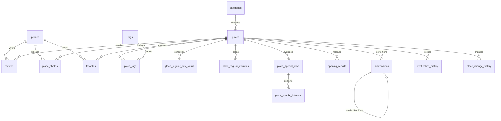

# Allnight — 데이터베이스 설계 명세서 (DB.md)

> 상태: Q1~Q13 인터뷰 확정사항 반영 · 구현용 설계 초안 v1.0  
> 대상: Claude / Next.js + TypeScript(잠정) / Supabase PostgreSQL + Auth + Storage / Naver Maps / Cloudflare(잠정)  
> 목적: 야간(18:00~익일 07:00) 영업 장소 검색, 신뢰도 표시, 제보·승인·리뷰·사진 관리  
> 원칙: **본 문서는 구현 계약이다.** SQL 작성 시 아래 불변조건과 보안 정책을 우선한다. 구현 환경과 Supabase 지원 기능은 실제 프로젝트에서 검증한다.

## 0. 구현 전에 알아야 할 사항

- 장소는 **브랜드가 아닌 개별 지점/시설** 단위로 관리한다.
- 공개 장소 정보는 누구나 조회하지만 **공식 장소 정보의 쓰기 권한은 관리자만** 가진다.
- 비회원도 신규 장소/정보 수정 제보 가능. 제보는 공개 데이터와 분리해 검토 후 반영한다.
- **검색 시 확인되지 않은 영업시간을 영업 중이라고 추정하지 않는다.**
- **장소 사진은 관리자만 등록·변경**하며 파일 유형/크기/권한을 서버에서 검증한다.
- 장소·리뷰는 소프트 삭제, 사진은 연결 제거 및 실제 Storage 파일 삭제.
- 영업시간은 한국 현지 시간 `Asia/Seoul` 기준으로 해석한다. PostgreSQL `time`은 로컬 시각, `date`는 현지 날짜, 감사 시각은 `timestamptz`를 쓴다.
- 개발/운영 Supabase 프로젝트를 분리하고 마이그레이션으로 스키마를 동일하게 유지한다.
- 출시 필수 DB를 먼저 구현하되 **즐겨찾기 테이블은 선생성**한다. 즐겨찾기 UI·전체 마이페이지는 2차 출시.

### 0.1 결정과 구현상 보완의 구분

**사용자 확정:** Q1~Q13의 기능·권한·범위·정책.  
**구현 제안(아래에서 명시):** 테이블/컬럼의 구체 이름, `UUID` PK, 정규화 방식, 시간 구간 모델, 사진 크기 제한값, 일부 인덱스/SQL 함수 등. Claude는 제안된 기술 세부를 프로젝트 호환성에 따라 조정할 수 있지만 확정 요구사항을 임의로 변경하지 않는다.

---

## 1. 데이터 모델 개요

### 1.1 1차 출시 핵심 테이블

| 테이블 | 역할 | 공개 읽기 | 쓰기 주체 |
|---|---|---|---|
| `profiles` | 회원 프로필/닉네임/역할 | 제한 | 본인 일부, 역할은 관리자 전용 |
| `categories` | 8개 대분류 | 가능 | 관리자 |
| `tags` | 관리형 표준 태그 | 가능 | 관리자 |
| `places` | 개별 장소/위치/검증 상태 | 공개 행만 | 관리자 |
| `place_tags` | 장소-태그 N:M | 공개 장소만 | 관리자 |
| `place_regular_day_status` | 요일별 영업/휴무/정보없음/24시간 | 공개 장소만 | 관리자 |
| `place_regular_intervals` | 요일별 다중 영업 구간 | 공개 장소만 | 관리자 |
| `place_special_days` | 특정 날짜 예외 상태 | 공개 장소만 | 관리자 |
| `place_special_intervals` | 예외 날짜의 다중 구간 | 공개 장소만 | 관리자 |
| `submissions` | 신규/수정 제보 및 승인 기록 | 제보자 본인(회원), 관리자 | 제보 API, 관리자 |
| `reviews` | 텍스트 리뷰 | 공개 리뷰만 | 작성자, 관리자 |
| `opening_reports` | 실제 영업 여부 제보 | 공개 노출은 집계/안내만 | 회원, 관리자/제한된 API |
| `place_photos` | 장소 이미지 메타데이터 | 공개 사진만 | 관리자만 |
| `verification_history` | 확인 근거/상태 변경 | 관리자 | 관리자 |
| `place_change_history` | 장소·영업시간 변경 전후 스냅샷 | 관리자 | 관리자 시스템 |
| `favorites` | 향후 즐겨찾기 | 본인 | 본인 (UI 2차) |

**추가 운영 테이블(필요 시):** `submission_events`(제보 처리 단계 이력), `import_batches` 및 `import_errors`(CSV 일괄 등록 추적). 1차 운영에 필요한 경우만 생성하되, 제보 최종 상태 및 검토자/검토시각은 반드시 `submissions`에 남긴다.

### 1.2 주요 관계



---

## 2. 공통 규칙

- PK는 기본 `uuid primary key default gen_random_uuid()`; `auth.users.id`와 연결하는 `profiles.id`는 동일 UUID를 사용한다.
- 생성·수정 시각: `created_at timestamptz not null default now()`, `updated_at timestamptz not null default now()`; `updated_at`은 트리거로 갱신.
- enum은 PostgreSQL ENUM 또는 `text + CHECK`로 일관되게 구현. 상태 변경 마이그레이션 용이성을 고려하면 `text + CHECK`도 적합.
- 외래 키에는 필요한 인덱스를 별도로 만든다. PostgreSQL은 FK 컬럼의 인덱스를 자동 생성하지 않는다.
- 클라이언트가 전달한 `role`, `reviewed_by`, `verified_by`, `approved_at` 등 권한·감사 필드는 신뢰하지 않고 서버 인증 컨텍스트로 결정.
- `places.deleted_at` 및 `reviews.deleted_at`이 존재하면 공개 조회에서 제외한다. 공개 여부를 조회하는 모든 함수/뷰에 동일한 조건을 적용.
- 개인 정보와 운영 이력의 보존 정책을 구분. 탈퇴 시 이메일 등 개인정보를 제거하고 작성자 식별 연결을 익명화하되 필요한 비식별 운영 이력만 유지한다. 법적 보존·삭제 의무는 별도 검토.

---

## 3. 상세 테이블 명세

### 3.1 `profiles`

| 컬럼 | 타입 | 제약/의미 |
|---|---|---|
| `id` | `uuid` | PK, FK `auth.users(id)`; 탈퇴 익명화 설계 시 `ON DELETE CASCADE`를 무조건 사용하지 말 것 |
| `nickname` | `varchar(40)` | NOT NULL, 고유 권장(대소문자/공백 정규화) |
| `role` | `text` | NOT NULL DEFAULT `'member'`, CHECK (`member`, `admin`) |
| `created_at`, `updated_at` | `timestamptz` | 공통 |

- 가입 시 필수 입력은 **이메일·비밀번호**. 닉네임은 서버/트리거에서 **랜덤 생성**해 자동 부여. 사용자가 추후 변경 가능하며 그대로 써도 된다.
- 랜덤 닉네임 예: `새벽고양이482`; 중복 시 재생성. 사용자가 닉네임을 직접 입력해야만 가입 가능한 UI로 구현하지 않는다.
- `role`은 안전한 서버 관리자 절차에서만 변경. 일반 회원이 본인 `role`을 갱신하는 RLS 정책을 절대 허용하지 않는다. 닉네임 변경은 역할 변경과 분리된 컬럼 제한 RPC 또는 안전한 서버 API로 처리.
- 탈퇴 시 `auth.users` 삭제와 `profiles` 참조 무결성·작성자 익명화 순서를 트랜잭션/관리자 서비스에서 처리한다.

### 3.2 `categories`

| 컬럼 | 타입 | 제약/의미 |
|---|---|---|
| `id` | `uuid` | PK |
| `slug` | `text` | UNIQUE NOT NULL, 변경에 신중 |
| `name` | `text` | NOT NULL |
| `sort_order` | `integer` | NOT NULL DEFAULT 0 |
| `is_active` | `boolean` | NOT NULL DEFAULT true |

초기 8개 대분류: **음식·카페 / 쇼핑·생활 / 학습·업무 / 의료·응급 / 여가·문화 / 운동·건강 / 교통·이동 / 기타**. 장소당 대표 카테고리 **정확히 하나** (`places.category_id NOT NULL`). 하위 카테고리 없음.

### 3.3 `tags` / `place_tags`

`tags`: `id uuid PK`, `name text NOT NULL`, `slug text UNIQUE NOT NULL`, `tag_type text NOT NULL CHECK (tag_type IN ('facility','atmosphere'))`, `is_active boolean NOT NULL DEFAULT true`, `sort_order integer NOT NULL DEFAULT 0`. `facility`=시설·서비스, `atmosphere`=분위기·특징.  
`place_tags`: `place_id uuid REFERENCES places(id)`, `tag_id uuid REFERENCES tags(id)`, `PRIMARY KEY(place_id,tag_id)`.

- 태그 생성·편집은 관리자만. 회원/비회원은 **기존 태그만 선택**, 태그 제안·자유 생성 없음.
- 비활성 태그는 신규 선택에서 제외하되 기존 장소 연결을 무조건 지우지 않는다.

### 3.4 `places`

| 컬럼 | 타입 | 제약/의미 |
|---|---|---|
| `id` | `uuid` | PK, 지점별 고유 ID |
| `name` | `text` | NOT NULL, 공백 이름 불허 |
| `category_id` | `uuid` | NOT NULL FK `categories(id)` |
| `address_full` | `text` | NOT NULL, 전체 주소 |
| `address_road` | `text` | 선택, 도로명 주소 |
| `address_detail` | `text` | 선택, 층/호수 등 |
| `province` | `text` | NOT NULL, 시·도 |
| `city_district` | `text` | NOT NULL, 시·군·구 |
| `neighborhood` | `text` | 선택, 읍·면·동 |
| `latitude` | `double precision` | NOT NULL, CHECK -90~90 |
| `longitude` | `double precision` | NOT NULL, CHECK -180~180 |
| `location` | `geography(Point,4326)` | PostGIS 검색용, 좌표와 동기화 |
| `naver_place_id` | `text` | NULL 허용, 확인 가능한 경우에만 저장 |
| `phone` | `text` | NULL 허용 |
| `website_url` | `text` | NULL 허용, URL 스킴 검증 |
| `verification_status` | `text` | NOT NULL DEFAULT `'unverified'`, `verified`/`needs_check`/`unverified` |
| `last_verified_at` | `timestamptz` | NULL 허용 |
| `has_pending_correction` | `boolean` | **파생값 권장**, 별도 저장 시 동기화 필수 |
| `created_at`, `updated_at` | `timestamptz` | 공통 |
| `deleted_at` | `timestamptz` | NULL이면 공개 가능 |

- `location`은 `ST_SetSRID(ST_MakePoint(longitude, latitude),4326)::geography`로 생성/동기화. 위도·경도 순서를 바꾸지 말 것. DB generated column 지원 여부를 확인하고, 불가하면 트리거로 동기화.
- 네이버 장소 ID는 **선택값**. 실제 네이버 API가 제공하는 식별자와 이용약관/보관 가능 여부를 구현 전에 확인한다. 필수키로 사용하지 않는다.
- `has_pending_correction`은 `submissions`에 미처리 수정 제보가 있는지로 계산하는 뷰/RPC를 우선 권장. `places`에 캐시하는 경우 승인·반려 시 원자적으로 갱신.
- `verification_status='verified'` 변경은 관리자만 가능. 미확인·확인 필요 상태와 마지막 확인 시각을 구분해 노출.
- 장소 삭제는 `deleted_at`을 설정하는 소프트 삭제. 연결된 리뷰/제보 이력은 유지하되 공개 조회에서 숨김.
- 중복 장소는 입력 중 유사 이름+거리+주소로 후보를 보여주고 **제보를 차단하지 않음**. 관리자가 최종 중복 판단.

### 3.5 정기 영업시간: `place_regular_day_status` / `place_regular_intervals`

**요일 기준:** `weekday smallint` = ISO 요일 1(월)~7(일). **구간의 요일은 영업이 시작되는 날짜**를 뜻한다.

`place_regular_day_status`:

| 컬럼 | 타입 | 제약/의미 |
|---|---|---|
| `place_id` | `uuid` | FK places, 복합 PK 일부 |
| `weekday` | `smallint` | 1~7, 복합 PK 일부 |
| `status` | `text` | `unknown` / `closed` / `open` / `open_24h` |
| `updated_at` | `timestamptz` | 수정 시각 |

`place_regular_intervals`:

| 컬럼 | 타입 | 제약/의미 |
|---|---|---|
| `id` | `uuid` | PK |
| `place_id` | `uuid` | FK places |
| `weekday` | `smallint` | 1~7, `day_status`와 복합 FK 권장 |
| `start_time` | `time without time zone` | NOT NULL |
| `end_time` | `time without time zone` | NOT NULL |
| `end_day_offset` | `smallint` | NOT NULL DEFAULT 0, CHECK IN (0,1) |
| `sort_order` | `smallint` | NOT NULL DEFAULT 0 |

**불변조건:**
1. `unknown`: 영업정보 미확인. **휴무가 아님**. 해당 요일 구간 없음.
2. `closed`: 확인된 휴무. 구간 없음.
3. `open_24h`: 해당 영업 시작일 00:00~익일 00:00의 24시간. 별도 구간 없음.
4. `open`: 유효한 구간 1개 이상. `end_day_offset=0`이면 종료가 시작보다 늦어야 하며, `end_day_offset=1`이면 다음 날 종료임을 명시. 하루 24시간 초과 구간 불허. 00:00~00:00의 모호한 표현 대신 `open_24h` 사용.
5. 한 장소에서 같은 날짜에 시작하는 구간끼리 겹치지 않도록 검증. **자정을 넘어 이전 날에서 이어진 구간과의 중복도 검사**한다.
6. 브레이크타임은 별도 폐쇄 구간이 아니라 **영업 구간을 나누어 저장**한다. 예: 11:00~15:00 + 17:00~23:00.
7. 관리 화면에 `24시간·연중무휴` 원클릭, `매일 같은 영업시간` 일괄 입력, 요일별 개별 수정 기능 제공. DB에는 7개 요일별 상태/구간으로 정규화해 저장.

**주의:** `open_24h`가 특정 요일에만 설정되면 그 요일 00:00~익일 00:00에만 적용한다. 연중무휴는 7개 요일 모두 `open_24h`로 설정하며, 날짜별 예외가 있으면 예외가 우선한다.

### 3.6 날짜별 예외: `place_special_days` / `place_special_intervals`

`place_special_days`: `id uuid PK`, `place_id uuid NOT NULL FK`, `local_date date NOT NULL`, `status text NOT NULL CHECK IN ('unknown','closed','open','open_24h')`, `note text NULL`, `created_at timestamptz`, `updated_at timestamptz`, `UNIQUE(place_id,local_date)`.

`place_special_intervals`: `id uuid PK`, `special_day_id uuid NOT NULL FK`, `start_time time NOT NULL`, `end_time time NOT NULL`, `end_day_offset smallint NOT NULL DEFAULT 0 CHECK IN (0,1)`, `sort_order smallint NOT NULL DEFAULT 0`.

- **특정 날짜의 예외는 그 날짜의 정기 영업시간 전체를 대체**한다. 일부 구간만 덧붙이는 방식이 아니다.
- 예외가 `closed`라면 그 날짜에 **새로 시작하는** 영업 구간은 없다. 단, 전날 시작해 해당 날짜 새벽까지 이어지는 구간은 자동 삭제하지 않는다. 전날 심야 구간까지 중단하려면 전날 예외도 수정해야 한다. 이 규칙을 관리자 UI에 안내한다.
- 예외 날짜의 구간/24시간/휴무/미확인 상태도 정기 영업시간과 동일한 검증을 적용.
- 날짜별 예외가 없는 날만 정기 스케줄을 사용. 공휴일 자동 휴무를 추정하지 않는다.

### 3.7 `submissions`

| 컬럼 | 타입 | 제약/의미 |
|---|---|---|
| `id` | `uuid` | PK |
| `type` | `text` | `new_place` / `correction` |
| `place_id` | `uuid` | `correction`이면 NOT NULL, `new_place`이면 NULL |
| `proposed_data` | `jsonb` | NOT NULL, 제안된 장소/시간/태그 데이터; 서버 스키마 검증 |
| `status` | `text` | `received` / `in_review` / `approved` / `rejected` |
| `submitted_by` | `uuid` | NULL 허용, 회원 FK profiles |
| `guest_email` | `text` | NULL 허용, 비회원 연락용; 공개 금지 |
| `previous_submission_id` | `uuid` | NULL 허용, 재제출 시 이전 제보 FK |
| `reviewed_by` | `uuid` | NULL 허용, 관리자 FK profiles |
| `reviewed_at` | `timestamptz` | NULL 허용 |
| `rejection_reason` | `text` | 반려 시 공백 아닌 값 필수 |
| `result_place_id` | `uuid` | 승인 후 반영된 장소 FK, NULL 허용 |
| `created_at`, `updated_at` | `timestamptz` | 공통 |

- 신규 제보는 이름, 주소/위치, 카테고리, 요일별 영업시간(모르는 요일은 `unknown` 가능)을 필수 수집. 비회원 이메일은 선택.
- **신규 제보는 승인 전 `places`에 공개 행으로 만들지 않는다.**
- 수정 제보도 승인 전 원본 `places` 및 영업시간 테이블을 변경하지 않는다.
- 반려 시 `rejection_reason` 필수. 재제출은 새 행으로 생성하고 `previous_submission_id` 연결. 기존 행은 불변 보존.
- 상태 전이는 `received -> in_review -> approved/rejected`를 기본으로 하며 필요 시 관리자가 `received`에서 직접 결정하는 경로는 별도 정책으로 명시. 승인/반려 이후 무단 수정 금지.
- 승인 시 관리자 서버 트랜잭션으로 (1) 상태/권한 재검증 (2) 공식 데이터 반영 (3) 변경 이력 기록 (4) 제보 상태·검토자 기록 (5) 관련 경고 상태 재계산을 원자적으로 수행.
- 비회원 제보는 **제한된 서버 API**를 통해서만 접수하고, 공개 `INSERT` RLS 정책을 만들지 않는다. 입력 검증, 요청 제한, 스팸 방지, 필요 시 CAPTCHA 적용. 비회원은 접수 결과 ID를 임의로 열람할 수 없도록 설계.
- 회원은 자신의 제보 상태/반려 사유만 조회 가능. 비회원 이메일 및 다른 사람 제보는 조회 불가.

### 3.8 `reviews`

`id uuid PK`, `place_id uuid NOT NULL FK`, `author_id uuid NULL FK profiles`, `body text NOT NULL`, `created_at timestamptz`, `updated_at timestamptz`, `deleted_at timestamptz NULL`, `hidden_by uuid NULL`, `hidden_reason text NULL`.

- 회원만 작성. 같은 장소에 **여러 리뷰 허용**. 별점·리뷰 사진 없음.
- 작성자 본인만 수정·소프트 삭제 가능. 관리자는 모더레이션 목적으로 숨김 처리 가능.
- `body`는 공백만 입력 불가, 최대 길이는 구현 시 합리적으로 제한(제안: 2,000자).
- 회원 탈퇴 시 작성자 연결을 NULL로 익명화하고 공개 리뷰는 필요한 정책에 따라 익명으로 유지.

### 3.9 `opening_reports`

`id uuid PK`, `place_id uuid NOT NULL FK`, `reporter_id uuid NULL FK profiles`, `reported_status text NOT NULL CHECK IN ('open','closed','uncertain')`, `observed_at timestamptz NOT NULL`, `note text NULL`, `created_at timestamptz NOT NULL DEFAULT now()`, `reviewed_by uuid NULL`, `reviewed_at timestamptz NULL`, `resolution text NULL`.

- 리뷰와 **별도 제보**. `open`(영업 중), `closed`(문 닫음), `uncertain`(확인 어려움).
- 실제 확인 날짜·시간을 기록. 서버는 미래 시각·비정상적 반복 요청을 검증.
- 영업 불일치 제보가 접수되면 공개 화면에 **'영업정보 확인 필요' 주의 표시**를 즉시 제공하고 관리자 검토 대상으로 등록. **기존 공식 영업시간을 자동 변경하거나 자동으로 '확인됨'으로 바꾸지 않는다.**
- 공개 API는 원본 제보자/메모를 무조건 노출하지 않고, 필요한 경고·집계만 제공. 제보는 회원 인증 또는 별도 제한된 API를 통한 접수로 구현; Q7은 리뷰와의 분리를 확정했으며 비회원 영업 확인 제보 허용 여부는 최종 구현 전에 확인할 수 있는 선택 사항이다.
- 검토가 완료된 제보가 계속 경고를 발생시키지 않도록 `resolution`/검토 시각을 활용한다. 동일 장소의 새 미해결 제보는 다시 경고를 띄운다.

### 3.10 `place_photos`

`id uuid PK`, `place_id uuid NOT NULL FK`, `storage_path text NOT NULL UNIQUE`, `uploaded_by uuid NULL FK profiles`, `sort_order integer NOT NULL`, `mime_type text NOT NULL`, `byte_size integer NOT NULL`, `created_at timestamptz NOT NULL DEFAULT now()`.

- 실제 파일은 Supabase Storage, DB에는 경로/소유자/정렬 순서 등 메타데이터만 저장.
- 장소 사진은 **관리자만 등록·변경·삭제**한다. 회원 및 비회원의 사진 업로드는 허용하지 않는다.
- **대표 사진 = `sort_order`가 가장 작고, 같으면 `created_at, id`가 빠른 사진**. 별도 `is_cover` 상태를 두지 않아도 됨. 삭제 시 다음 사진이 자동 대표가 된다.
- 사진 삭제는 관리자만 가능하다. 일반 회원에게 사진 삭제 UI를 제공하지 않는다.
- 파일 검증: 실제 MIME/매직바이트 확인, 이미지 형식 제한(제안: JPEG/PNG/WebP), 크기 제한(제안: 장당 5MB), 확장자만 신뢰 금지, 임의 파일명, 경로에 사용자/장소 식별값 사용, 업로드 요청 제한. EXIF 위치 등 민감 메타데이터 제거/재인코딩 권장.
- 삭제는 **메타데이터 제거 + Storage 파일 제거**. 서로 다른 시스템이므로 원자적 트랜잭션이 불가능하다. 삭제 작업의 재시도·실패 정리(고아 파일 검사)를 구현한다.
- 공개 버킷을 사용한다면 DB RLS만으로 비공개/삭제된 장소의 사진 URL 접근을 완전히 제한할 수 없다. 공개 버킷/서명 URL/삭제 정책을 실제 요구에 맞춰 선택하고, 소프트 삭제된 장소의 사진 노출도 차단한다.

### 3.11 `verification_history`

`id uuid PK`, `place_id uuid NOT NULL FK`, `previous_status text NULL`, `new_status text NOT NULL`, `verified_by uuid NOT NULL FK profiles`, `verification_method text NULL`, `source_reference text NULL`, `note text NULL`, `created_at timestamptz NOT NULL DEFAULT now()`.

- 확인 방법/출처는 선택: 전화, 공식 사이트, 현장 확인, 사용자 제보 등.
- 관리자만 '확인됨' 처리. 관리자가 실제 영업정보를 새로 확인한 경우에만 이력 추가 및 `places.last_verified_at` 갱신. 단순 상태·데이터 수정은 확인일 갱신 사유가 아니다.
- 확인 이력은 원칙적으로 장기 보관. 개인 연락처 등 불필요한 개인정보를 기록하지 않도록 UI 안내.

### 3.12 `place_change_history`

`id uuid PK`, `place_id uuid NOT NULL FK`, `changed_by uuid NULL FK profiles`, `change_type text NOT NULL`, `before_data jsonb NULL`, `after_data jsonb NULL`, `source_submission_id uuid NULL FK submissions`, `created_at timestamptz NOT NULL DEFAULT now()`.

- 장소 기본정보·태그·영업시간·예외·삭제/복구 등 **중요 변경** 시 변경 전후 스냅샷 기록.
- 기록은 관리자 전용 읽기. 애플리케이션에서 임의 수정/삭제 금지. 가능하면 DB 함수/트리거에서 기록.
- JSON 스냅샷에 제보자 이메일·인증 토큰 등 개인정보/비밀정보를 넣지 않는다.

### 3.13 `favorites` (선생성, UI 2차)

`user_id uuid NOT NULL FK profiles`, `place_id uuid NOT NULL FK places`, `created_at timestamptz NOT NULL DEFAULT now()`, `PRIMARY KEY(user_id,place_id)`.

- 1차에 테이블과 본인 전용 RLS만 생성. **즐겨찾기 화면·전체 마이페이지는 2차 출시**.
- 삭제된 장소는 공개 즐겨찾기 목록에서 제외. 계정 탈퇴 시 즐겨찾기 연결 삭제.

---

## 4. 시간 검색 엔진 — 핵심 구현 계약

### 4.1 시간 범위 정의

- 검색 입력: `start_at`, `end_at`은 **한국 시간대를 포함한 절대 시각**으로 서버에 전달하는 것을 권장. UI는 현지 날짜/시각을 선택하며, 자정 이후 종료를 익일로 해석.
- 구간은 **반열린 구간 `[start,end)`**. 종료 시각과 검색 시작 시각이 정확히 같으면 겹치지 않는다.
- 날짜별 예외 및 주간 반복을 검색 구간에 해당하는 **실제 현지 날짜로 펼친 뒤** 판정한다. 단순히 `현재 요일 = weekday`만 검사하면 전날부터 이어지는 심야 영업을 놓친다.
- 자정 넘는 구간: 시작일 `D`의 `start_time`, 종료일 `D + end_day_offset`의 `end_time`으로 구체화. `open_24h`는 `[D 00:00, D+1 00:00)`.
- 검색 구간에 영향을 줄 수 있는 **전날 시작 영업 구간도 반드시 포함**한다.

### 4.2 영업 구간 구성 절차

1. 검색 범위와 겹칠 가능성이 있는 날짜(최소 검색 시작일 전날부터 종료일까지)를 구한다.
2. 각 날짜마다 `place_special_days`가 있으면 이를 사용하고, 없으면 `place_regular_day_status` 및 해당 요일 구간을 사용한다.
3. `closed`는 빈 영업 구간, `unknown`은 미확인 구간, `open_24h`는 24시간 구간, `open`은 각 구간을 절대 시각으로 변환한다.
4. 전날부터 이어진 구간을 포함해 모든 확인된 영업 구간을 시간순으로 정렬하고, 겹치거나 맞닿은 구간은 **병합**한다.
5. 검색 범위 전체가 병합된 영업 구간의 합집합으로 덮이면 `full`, 일부라도 겹치면 `partial`, 확인된 영업 구간과 겹치지 않지만 해당 검색 범위에 **미확인 상태가 존재하면 `unknown`**, 완전히 확인된 비영업이면 `closed`로 판정한다.
6. 날짜별 예외가 있는 날에도 전날 시작한 영업 구간은 3.6절 규칙에 따라 살아 있다.

**중요:** 검색 범위의 일부가 미확인인 경우, 확인된 구간이 다른 일부를 덮더라도 전체 영업으로 간주하지 않는다. `full`은 **모든 순간이 확인된 영업 구간으로 덮일 때만** 부여한다. `partial`은 확인된 일부 영업이 존재하는 경우에만 부여한다. 검색 결과에서 미확인 상태를 별도 경고로 함께 표시할 수 있다.

### 4.3 결과 포함·정렬

- 포함: `full`, `partial`, `unknown`, `closed`. `closed`도 최하단 그룹에 표시한다.
- 그룹 순서: `full` → `partial` → `unknown` → `closed`.
- `full`은 확정 검색 중심점 거리순, `partial`은 선택 구간과 실제 영업 구간의 교집합 총 분 내림차순 후 거리순, `unknown`과 `closed`는 각 그룹 내 거리순. 동일 조건은 `id`로 안정적 정렬.
- `unknown`은 '영업정보 확인 필요' 안내. `verification_status`는 영업시간 커버리지와 **별개의 신뢰도 정보**로 표시.
- 기본 검색은 현재 시각, 사용자 지정 시작/종료 범위 검색 지원. 시간 범위가 너무 길어 계산량이 커지지 않도록 서버 제한(예: 48시간)을 두는 것은 구현 제안이며 UI 요구에 맞춰 조정.
- 야간 필터의 범위는 18:00~익일 07:00 중심이지만, 정확한 영업 구간 자체는 낮 시간도 저장해야 한다.

### 4.4 테스트 케이스 (필수)

| 사례 | 저장 데이터 | 검색 | 기대 |
|---|---|---|---|
| 익일 종료 | 금 18:00~토 02:00 | 토 00:30~01:30 | `full` |
| 일부 겹침 | 금 18:00~토 02:00 | 금 23:00~토 03:00 | `partial` |
| 접점만 일치 | 금 18:00~토 02:00 | 토 02:00~03:00 | `closed`(다른 구간 없을 때) |
| 브레이크타임 | 토 11~15, 17~23 | 토 14~18 | `partial` |
| 연중무휴 | 매일 `open_24h` | 임의 날짜 23~익일 03 | `full` |
| 날짜별 휴무 | 평소 월 24h, 특정 월 `closed` | 그 월 12~13 | `closed`(전날 연장 영업 없을 때) |
| 일부 정보 없음 | 월 `unknown` | 월 22~23 | `unknown` |
| 전날 이어짐 | 일 22~월 03, 월 `closed` | 월 01~02 | `full` |
| 예외 우선 | 화 18~익일 02, 특정 화 20~23 | 화 23:30~익일 00:30 | `closed`(다른 구간 없을 때) |
| 복수 구간 병합 | 월 18~22, 22~익일 02 | 월 21~익일 01 | `full` |

### 4.5 구현 방법

- 시간 판정은 **서버/DB 측**에서 수행. 우선순위는 정확성 > 조기 최적화.
- PostgreSQL 함수(`search_places(...)`) 또는 서버의 검증된 SQL/RPC로 구현하고, 반환값에 `coverage_status`, `distance_meters`, `verification_status`, `has_unresolved_report`, `has_pending_correction` 포함.
- 대규모 확장 시 날짜별 영업 구간을 임시/캐시 테이블로 전개하는 방식 검토. 캐시를 사용한다면 정기/예외 시간 변경 시 무효화 필수.
- PostGIS 후보 검색으로 장소 수를 줄인 후 시간 구간을 계산. **시간 필터를 브라우저에서만 처리하지 않는다.**

---

## 5. 위치 검색·지도 연동

- `places.location`은 PostGIS `geography(Point,4326)`; `ST_DWithin`(반경) 및 `ST_Distance`(거리)를 사용한다.
- 지도 현재 영역 검색은 지도 bounds의 북/남/동/서 경계를 서버로 보내 후보 검색. 날짜변경선 등 극단적 경계는 필요 시 처리.
- 검색어는 장소명/주소 대상. Naver 지도 API는 지도 표시·주소/장소 검색 보조이며 **영업시간의 단일 진실 원천은 Allnight DB**.
- 지도 이동 시 자동 재검색하지 않고 **'이 지역 검색' 버튼**으로 요청. 검색어·필터·지도 위치를 URL/화면 상태로 복원하는 기능은 SITEMAP 구현 사항.
- 카테고리·태그·검증 상태·24시간 여부 필터 지원. 24시간 여부는 정기/예외 시간과 검색 날짜를 고려해 판단하며 단순 `places.is_24h` 상수로 결정하지 않는다.

---

## 6. 인덱스 및 제약조건

### 6.1 권장 인덱스

```sql
-- PostGIS extension은 Supabase 프로젝트에서 지원 위치/스키마를 확인
CREATE INDEX places_location_gix ON public.places USING GIST (location)
  WHERE deleted_at IS NULL;
CREATE INDEX places_category_live_idx ON public.places (category_id)
  WHERE deleted_at IS NULL;
CREATE INDEX places_region_live_idx ON public.places (province, city_district)
  WHERE deleted_at IS NULL;
CREATE INDEX places_verification_live_idx ON public.places (verification_status)
  WHERE deleted_at IS NULL;
CREATE INDEX place_tags_tag_idx ON public.place_tags (tag_id, place_id);
CREATE INDEX regular_intervals_lookup_idx ON public.place_regular_intervals (place_id, weekday);
CREATE INDEX special_days_lookup_idx ON public.place_special_days (place_id, local_date);
CREATE INDEX submissions_queue_idx ON public.submissions (status, created_at DESC);
CREATE INDEX submissions_place_idx ON public.submissions (place_id, status);
CREATE INDEX submissions_author_idx ON public.submissions (submitted_by, created_at DESC);
CREATE INDEX reviews_place_live_idx ON public.reviews (place_id, created_at DESC)
  WHERE deleted_at IS NULL;
CREATE INDEX opening_reports_place_idx ON public.opening_reports (place_id, created_at DESC);
CREATE INDEX photos_place_sort_idx ON public.place_photos (place_id, sort_order, created_at, id);
CREATE INDEX verification_place_idx ON public.verification_history (place_id, created_at DESC);
CREATE INDEX changes_place_idx ON public.place_change_history (place_id, created_at DESC);
CREATE INDEX favorites_place_idx ON public.favorites (place_id);
```

> 위 SQL은 인덱스 예시이며, **테이블 생성 후** 실행한다. `location` 생성 칼럼/확장 스키마는 실제 Supabase 버전에 맞춰 검증한다. 인덱스는 `EXPLAIN (ANALYZE, BUFFERS)`로 검증하고 필요 시 조정.

### 6.2 무결성 규칙

- `places` 주소/좌표/카테고리 필수. `latitude`/`longitude` 유효 범위 확인.
- `submissions.type`과 `place_id`의 조합 CHECK (`new_place`면 NULL, `correction`이면 NOT NULL).
- `submissions.status='rejected'`이면 공백 아닌 `rejection_reason` 필수; 승인 시 `reviewed_by`/`reviewed_at` 필수.
- `place_regular_day_status`의 `(place_id, weekday)` UNIQUE/PK. `place_special_days`의 `(place_id,local_date)` UNIQUE.
- 구간 시작/종료/익일 여부 및 겹침 검사는 **트랜잭션 수준 검증**. 여러 행 간 조건은 단순 CHECK만으로 불충분하므로 서버 함수/트리거 또는 배타 제약 사용.
- 승인·사진 업로드·역할 변경은 동시성/재시도에 안전하도록 처리. 제보 승인 시 행 잠금(`SELECT ... FOR UPDATE`) 또는 상태 조건부 업데이트로 중복 승인 방지.
- `naver_place_id`는 NULL 허용; 식별자 안정성/유일성 확인 전 전역 UNIQUE를 무조건 걸지 않는다.
- `reviews` 및 `place_photos`는 공개·삭제된 장소에 대한 쓰기를 제한.

---

## 7. RLS 및 서버 보안

### 7.1 기본 원칙

1. 공개 스키마의 사용자 접근 가능 테이블은 **모두 RLS 활성화**.
2. 관리자 판정은 신뢰 가능한 DB 함수(`is_admin()`) 또는 안전한 서버 인증 검사로 수행. JWT의 사용자 편집 가능 메타데이터나 브라우저 상태를 관리자 권한의 유일한 근거로 사용하지 않는다.
3. RLS는 행 단위 보호이며, **열 단위 보호는 별도**. 예: `profiles.role`은 일반 회원이 `UPDATE`하지 못하도록 컬럼 권한/전용 RPC 사용.
4. `service_role` 비밀 키는 브라우저에 절대 노출하지 않는다. 서버에서도 필요한 작업에만 사용.
5. `SECURITY DEFINER` 함수를 사용하면 `search_path` 고정, 입력 검증, 최소 권한 부여, 함수 소유자·실행 권한 감사.
6. Supabase Storage는 `storage.objects` 정책 및 버킷 정책을 **DB 메타데이터 RLS와 함께** 설정.

### 7.2 권한 매트릭스

| 리소스/행위 | 비회원 | 회원 | 관리자 |
|---|---|---|---|
| 공개 장소·영업시간·태그 조회 | 허용 | 허용 | 허용 |
| 공식 장소/시간/검증 상태 직접 변경 | 금지 | 금지 | 허용 |
| 신규·수정 제보 제출 | 제한 서버 API | 제한 서버 API | 허용 |
| 제보 상세/연락처 조회 | 금지 | 본인 것만(연락처 공개 주의) | 허용 |
| 제보 승인·반려 | 금지 | 금지 | 허용 |
| 공개 리뷰 조회 | 허용 | 허용 | 허용 |
| 리뷰 작성 | 금지 | 허용 | 허용 |
| 리뷰 수정·삭제 | 금지 | 본인 것만 | 전체 관리 |
| 영업 여부 제보 | 별도 정책 확정 필요 | 허용 | 허용 |
| 사진 업로드 | 금지 | 금지 | 허용 |
| 사진 삭제 | 금지 | 금지 | 전체 |
| 프로필 수정 | 금지 | 본인 닉네임만 | 관리자 절차 |
| 역할 변경 | 금지 | 금지 | 안전한 관리자 절차만 |
| 확인·변경 이력 조회 | 금지 | 금지 | 허용 |
| 즐겨찾기 | 금지 | 본인 것만 | 본인 것만 |

### 7.3 RLS 구현 주의점

- `places` 공개 SELECT 정책은 `deleted_at IS NULL`; 관련 시간·사진·태그 테이블도 **연결 장소의 공개 여부**를 확인해야 한다.
- `submissions`에는 비회원 직접 INSERT 허용 정책을 두지 말고 서버 검증 경로를 사용. 서버 API는 관리자 키 사용 시에도 요청 제한/스키마 검증을 반드시 수행.
- 회원 리뷰 INSERT에서 `author_id=auth.uid()` 및 장소 공개 여부 확인. UPDATE/DELETE는 `author_id=auth.uid()` 조건과 `WITH CHECK`를 모두 검토.
- 관리자 사진 INSERT에서 관리자 권한과 Storage 경로/장소 검증. **메타데이터만 INSERT해 타인의 파일 경로를 가리키는 행을 만들 수 없도록** 서버 측 업로드 완료 검증을 권장.
- Storage 직접 업로드를 허용할 경우 경로 규칙, MIME, 용량, 파일 소유자 정책을 강제. 안전한 서버 업로드 API 또는 서명된 업로드 URL을 고려.
- 관리자 등록 사진의 공개 및 삭제 시 실제 파일 제거 정책이 충돌하지 않도록 삭제 재시도/고아 파일 정리 작업 마련.
- 비회원에게는 `profiles` 이메일이나 제보 연락처를 공개하지 않는다. 인증 이메일은 `auth.users`에 보관하며 일반 공개 프로필에 복사하지 않는 것이 바람직.

---

## 8. 주요 트랜잭션·서비스 로직

### 8.1 회원가입

1. Supabase Auth에서 이메일/비밀번호 가입.
2. Auth 사용자 생성 시 프로필 자동 생성(트리거 또는 안전한 서버 처리), 랜덤 닉네임 부여.
3. 역할 `member`로 강제. 사용자 입력으로 `admin` 지정 불가.
4. 닉네임 변경은 별도 검증 후 본인에게만 허용.

### 8.2 신규 장소 승인

1. `submissions` 행 잠금 및 관리자 인증.
2. `proposed_data` 스키마·좌표·카테고리·시간·중복 후보 재검증.
3. `places` + 요일 상태/구간 + 태그 등을 생성.
4. `place_change_history` 기록 및 `submissions` 승인/결과 장소 ID 업데이트.
5. 모두 하나의 DB 트랜잭션으로 커밋. 오류 시 전체 롤백.

### 8.3 정보 수정 승인

1. 대상 장소와 제보 행 잠금, 관리자 인증.
2. 변경 전 장소·시간·태그 스냅샷 확보.
3. **제보가 제안한 필드만** 공식 데이터에 반영하고, 다른 필드는 유지. 제보 스키마에 `unset`/`null`/미제출을 명확히 구분.
4. 변경 후 스냅샷·제보 승인 기록·확인 필요 경고 재계산.
5. 한 트랜잭션으로 완료. 영업정보가 수정되었다고 해서 자동으로 `verified` 처리하지 않는다.

### 8.4 영업 불일치 제보

1. `opening_reports` 생성(확인 시각·상태 검증).
2. `closed` 제보 등 불일치 제보는 즉시 미해결 주의 표시 대상으로 집계.
3. 관리자가 확인 후 해결 처리/필요 시 공식 영업시간 변경 및 확인 이력 기록.
4. 원본 영업시간은 승인 전까지 그대로 유지.

### 8.5 장소/리뷰 삭제

- 장소: `deleted_at` 설정, 공개 검색·상세·사진 노출 제외, 운영 기록 유지.
- 리뷰: `deleted_at` 설정, 공개 조회 제외, 작성자/관리자 이력 보존.
- 사진: 메타데이터와 Storage 객체를 모두 삭제. 장애 시 재시도 가능한 작업으로 구현.

### 8.6 CSV 일괄 등록

- 관리자가 CSV 파일 업로드 또는 운영자 전용 스크립트 실행.
- 컬럼 템플릿: `name`, `address_full`, `province`, `city_district`, `latitude`, `longitude`, `category_slug`, `naver_place_id?`, `phone?`, `website_url?`, `verification_status`, 요일별 상태/구간, 태그.
- 1차 검증(형식/필수값/좌표/시간 구간/카테고리), 2차 중복 후보 검사, **미리보기와 오류 행 표시**, 확인 후 일괄 입력.
- 부분 성공/전체 롤백 정책을 명시. 권장: 파일을 작은 배치로 나누고 배치별 트랜잭션, 실패 행 별도 보고.
- 임포트 완료 후 관리자가 개별 수정 가능. CSV 데이터도 변경·확인 이력의 출처로 추적할 수 있도록 배치 ID 저장 권장.

---

## 9. 검색 API 계약 (권장)

**예시:** `POST /api/places/search`

```json
{
  "bounds": {"north": 36.85, "south": 36.75, "east": 127.20, "west": 127.05},
  "center": {"lat": 36.81, "lng": 127.15},
  "startAt": "2026-11-06T23:00:00+09:00",
  "endAt": "2026-11-07T03:00:00+09:00",
  "categoryIds": [],
  "tagIds": [],
  "verificationStatuses": [],
  "only24h": false,
  "query": "카페",
  "limit": 50,
  "cursor": null
}
```

**응답 항목 예시:** `id`, `name`, `category`, `lat`, `lng`, `distanceMeters`, `coverageStatus` (`full|partial|unknown|closed`), `verificationStatus`, `lastVerifiedAt`, `hasPendingCorrection`, `hasUnresolvedOpeningReport`, `todayHoursSummary`, `coverPhotoUrl`.

- 커서 페이지네이션/지도 영역 결과 제한을 지원. 정렬 키와 커서가 일치하도록 구현.
- SQL 인젝션 방지를 위해 매개변수 바인딩 사용. 임의 ORDER BY 컬럼 문자열 결합 금지.
- 비회원도 검색 가능. 개인정보/제보 원문은 응답에 포함하지 않는다.
- `/place/:id`는 고유 장소 ID로 조회하고, 삭제/미존재 장소는 안전한 오류 상태 반환.

---

## 10. 데이터 보존·백업·환경

- **운영 이력:** 장소 변경/확인/제보 승인·반려 기록은 원칙적으로 기한 없이 보관. 개인정보는 별도 보존/삭제 기준 적용.
- **백업:** Supabase 프로젝트 요금제의 DB 백업·복원 지원 범위를 실제 확인하고, 주요 장소/영업시간/태그/제보 데이터를 정기 CSV로 내보내기. **CSV는 관계·정책·Auth·Storage까지 완전 복구하는 백업이 아님.**
- **Storage:** DB 백업과 별도로 사진 객체 백업/복구 필요 여부 검토. 실제 파일 삭제 정책은 준수.
- **복구 테스트:** 개발용 프로젝트에 백업 복원을 시험해 장소/시간/관계/RLS가 정상인지 검증.
- **환경:** 개발용 Supabase와 운영용 Supabase를 분리. 환경변수, 키, Storage 버킷, Auth 리디렉션 URL도 분리. 운영 데이터를 개발 DB에 무단 복사하지 않는다.
- **마이그레이션:** 버전 관리된 SQL 마이그레이션 사용, 초기 8개 카테고리와 기본 태그는 seed 데이터로 관리.

---

## 11. 출시 범위

### 11.1 1차에 실제 구현

- 장소·위치·카테고리·관리형 태그, 요일별/예외 영업시간, PostGIS 위치+시간 검색.
- 공개 지도·목록·장소 상세·검색/필터·영업정보 경고.
- Supabase Auth 가입/로그인 및 랜덤 닉네임 프로필.
- 비회원 포함 신규/수정 제보, 관리자 승인/반려, 변경/확인 이력.
- 회원 텍스트 리뷰, 실제 영업 여부 제보, 관리자 전용 장소 사진 등록·변경·삭제.
- 관리자 대시보드, 장소/영업시간/태그/제보/리뷰/사진 관리.
- CSV 초기 일괄 입력 + 관리자 개별 입력, 주요 데이터 내보내기, 백업 운영.
- `favorites` 테이블 및 RLS는 **미리 생성**.

### 11.2 2차 이후

- 즐겨찾기 화면과 사용자 저장 목록.
- 전체 마이페이지(내 리뷰/내 제보 이력 등 통합 UI).
- 사용자 사진 신고 기능 및 별도 신고 처리 테이블.
- 사용자 태그 제안/자유 생성 기능은 **현 시점 계획에 포함하지 않음**.
- 회원 관리 대시보드는 1차 관리자 범위에서 제외.

---

## 12. 권장 구현 순서

1. Supabase 개발/운영 프로젝트 생성, PostGIS 확장 확인, 환경변수 분리.
2. `profiles`, 관리자 판정 함수, 닉네임 자동 생성, 역할 변경 보호.
3. `categories`, `tags`, `places`, `place_tags` + 기본 인덱스/공개 RLS.
4. 정기 영업시간·날짜별 예외 테이블, 데이터 무결성 검사, 24시간/일괄 입력 변환 로직.
5. 날짜 전개/심야 시간 검색 SQL/RPC + 필수 테스트 케이스.
6. `submissions` 및 비회원 제보 API, 승인/반려 트랜잭션, 변경 이력.
7. `verification_history`, `opening_reports`, 미해결 제보 경고 집계.
8. `reviews` 및 본인 수정/소프트 삭제 RLS.
9. Storage 버킷, `place_photos`, 안전한 업로드/즉시 공개/삭제 정리.
10. `favorites` 테이블/RLS 선생성(화면은 보류).
11. CSV 가져오기/내보내기, 백업·복원 테스트.
12. 전체 RLS 침투 테스트, 성능 측정, 관리자/비회원 시나리오 테스트, 운영 배포.

---

## 13. 검수 체크리스트

- [ ] 비회원은 공개 장소를 조회할 수 있지만 공식 장소/시간을 직접 수정할 수 없다.
- [ ] 일반 회원이 자기 `role`을 `admin`으로 바꿀 수 없다.
- [ ] 신규 제보는 승인 전 지도에 노출되지 않는다.
- [ ] 수정 제보는 승인 전 원본 영업시간을 바꾸지 않는다.
- [ ] 반려 사유는 필수이며 재제출은 원본 제보와 연결된다.
- [ ] `unknown`과 `closed`가 DB와 UI에서 명확히 구분된다.
- [ ] 24시간/연중무휴와 매일 같은 시간의 일괄 입력이 가능하다.
- [ ] 익일 종료·브레이크타임·날짜별 예외·전날 심야 구간을 정확히 판정한다.
- [ ] 전체 영업/일부 영업/미확인 순으로 결과가 정렬된다.
- [ ] 영업 불일치 제보는 즉시 경고를 띄우지만 공식 영업시간을 자동 변경하지 않는다.
- [ ] 리뷰는 여러 개 작성 가능하고 별점·사진이 없다.
- [ ] 관리자만 장소 사진을 등록·변경·삭제할 수 있고 삭제 시 Storage 객체도 제거된다.
- [ ] 장소/리뷰 소프트 삭제 후 공개 API에서 조회되지 않는다.
- [ ] 변경 이력·확인 이력은 관리자만 조회 가능하다.
- [ ] 즐겨찾기 테이블은 존재하지만 1차 화면에는 노출되지 않는다.
- [ ] 개발/운영 환경이 분리되고 백업 복원 테스트를 통과한다.

## 14. 구현 전 확인할 기술·정책 세부

아래는 인터뷰에서 기능 방향은 정해졌지만 **숫자·세부 보안 정책까지 확정되지는 않은 항목**이다. Claude가 임의로 사용자 요구사항을 바꾸지 말고 안전한 기본값을 제안·검증한다.

1. 비회원의 **실제 영업 여부 제보** 허용 범위(신규/수정 장소 제보는 비회원 허용 확정).
2. 관리자 전용 장소 사진 업로드 제한(장수, 크기, 파일 형식, 일일 횟수).
3. 랜덤 닉네임 생성 규칙·닉네임 중복 허용 여부·변경 횟수 제한.
4. 관리자 변경 이력의 구체적인 JSON 스냅샷 구조와 동시성 제어.
5. 검색 기본 반경·페이지 크기·최대 시간 범위·동일 그룹 내 세부 정렬.
6. CSV 가져오기 기능의 1차 관리자 UI 범위(업로드 화면 vs 운영자 스크립트). **일괄 등록 기능 자체는 1차 확정**.
7. Supabase 요금제별 백업 기능, PostGIS 확장 설치 방식, Naver 장소 ID의 API/약관상 저장 가능 여부.
8. 사진 공개 버킷 정책과 소프트 삭제 장소의 기존 이미지 URL 노출 처리.

**최종 원칙:** 기능을 단순화할 필요가 생기면 `DB.md`를 조용히 무시하지 말고, 어떤 확정 요구사항이 바뀌는지 사용자에게 먼저 설명한다.

---

## 최종 검토 Q1–Q8 확정 사항 (2026-11-05)

> 이 절은 사용자 승인으로 확정된 최신 정책이다. 같은 문서 또는 다른 문서의 이전 **잠정/권장/확인 필요** 문구와 충돌하면 이 절을 우선 적용한다. 단, 구현상 추가 확인이 필요한 외부 API 제약은 검증한다.

1. **장소 상세:** 대표 사진이 있으면 뒤로가기 다음의 최상단 사진 헤더로 표시한다. 사진이 없으면 영역을 생략한다. 장소명과 선택 시간 영업 상태를 이어서 표시한다. 주간 영업시간은 기본 접힘, 사용자 조작으로 7일 시간표를 펼친다. 적용되는 특별 영업/임시 휴무 등 예외는 접힘 상태에서도 상단에 안내하고 실제 영업 판정에 반영한다.
2. **지도와 필터:** 지도 이동만으로는 재검색하지 않는다. '이 지역 검색'을 눌렀을 때 검색 영역을 변경한다. 지도만 이동한 상태에서 카테고리/태그/시간 필터를 변경해도 **마지막으로 확정된 검색 영역**을 대상으로 검색한다. 카테고리/태그는 변경 즉시 검색한다. 시간 슬라이더는 드래그 중 선택 시각 표시만 갱신하고, 놓았을 때 서버에 검색 요청한다.
3. **검색 결과 그룹 및 정렬:** `full`(전체 영업) → `partial`(일부 영업) → `unknown`(영업정보 미확인) → `closed`(선택 시간에 영업하지 않음) 순으로 **모든 그룹을 표시**한다. `full`은 확정 검색 지도 중심과의 거리순, `partial`은 선택 구간 중 실제 영업 시간의 총 길이 내림차순 후 거리순, `unknown`은 하단 별도 그룹, `closed`는 최하단 별도 그룹이다. 동일 조건의 안정적 정렬을 위해 ID 등 결정적 타이브레이커를 사용한다. 미확인 장소를 영업 중이라고 단정하지 않는다.
4. **정보 신뢰도:** 마지막 관리자 실확인 시각으로부터 **30일 초과** 시 '정보 오래됨' 경고를 표시하되 원래 그룹과 정렬은 유지한다. '영업하지 않음' 이용자 제보가 접수되면 관리자 확인 전에도 '영업 여부 제보 있음' 경고를 표시하고 기존 영업시간 판정은 유지한다. **확인일은 관리자가 실제 영업정보를 확인했을 때만** 갱신하며, 단순 제보 접수나 데이터 수정만으로 갱신하지 않는다.
5. **콘텐츠 운영:** 회원 텍스트 후기(별점/후기 사진 없음)는 작성 즉시 공개하며 신고 후 관리자 검토한다. 장소 대표 사진의 등록/변경은 관리자만 할 수 있다. 장소 신규 등록/정보 수정 제보는 승인 전 실제 장소 데이터에 반영하지 않으며, 제출자에게 접수 안내를 제공하고 **회원에게는 본인 제보의 검토 상태 조회**를 제공한다. 비회원 제보도 기존 허용 원칙을 유지하되 계정 없는 제보자에게 회원용 조회 기능을 약속하지 않는다.
6. **시간 검색:** 시작 날짜만 선택하며 종료 날짜는 자정 통과에 따라 자동 계산한다. 슬라이더 범위는 **18:00~다음 날 07:00**, 30분 단위이다. **특정 시각과 시간 구간** 검색을 모두 지원한다. 미래 날짜 검색 상한은 두지 않으며, 반복 영업시간과 등록된 날짜별 예외로 계산한다. 미등록 미래 예외는 보장하지 않는다고 안내한다. '지금' 기본값이 30분 격자와 맞지 않을 경우 실제 현재 시각을 유지할지 스냅할지는 구현 전 별도 확인이 필요하다.
7. **기술 스택:** **Next.js + TypeScript**, **Cloudflare 배포**, **네이버 지도 API**, **Supabase PostgreSQL + PostGIS / Auth / Storage** 확정. Next.js의 Cloudflare 런타임/배포 어댑터 호환성, 네이버 지도 다크 테마 지원 여부는 구현 전 기술 검증한다. 검증 없이 프레임워크를 임의 변경하지 않는다.
8. **초기 데이터:** 직접 검증한 실제 장소 **30개**를 최초 공개 목표로 한다.

**DB/API 주의:** 이전 검색 응답의 `coverageStatus: full|partial|unknown`은 `closed`를 포함하도록 확장해야 한다. 부분 영업시간의 정렬값(선택 구간과 실제 영업 구간의 교집합 총 분)을 계산·반환 또는 서버 내부 정렬 키로 사용한다. `unknown`과 `closed`는 별도 상태이며 혼합하지 않는다. 페이지네이션은 그룹·정렬 순서를 유지해야 한다.
